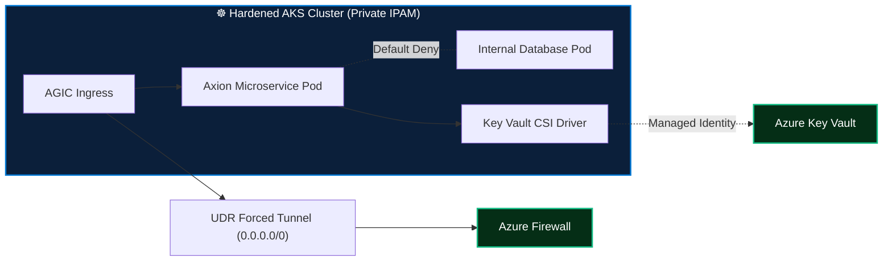

<div align="center">

# ☸️ Zero-Trust Multi-Tenant Kubernetes (AKS) Platform

[](https://kubernetes.io)
[](#)
[](#)
[](#)

**Production-hardened, zero-trust container orchestration framework deployed on private Azure Kubernetes Service (AKS) with automated GitOps delivery pipelines.**

</div>

---

## 🛡️ Architecture & Security Baselines

- 🔒 **Private Cluster Topology:** API server accessible strictly via Private Endpoints and internal jumpboxes. Zero public exposure.
- 🌐 **Calico Network Policies:** Default-deny ingress and egress across all tenant namespaces. Explicit whitelisting for DNS and inter-service telemetry.
- 🔑 **Azure Key Vault Secrets Store CSI Driver:** Elimination of hardcoded Kubernetes secrets; secrets mounted as in-memory volumes with automated 2-minute rotation.
- ⚡ **Egress Traffic Control:** Forced tunneling via User Defined Routing (UDR) through central Azure Firewall for TLS inspection.
- 📦 **Stateful Persistence:** Azure Managed Disk CSI driver with automated volume snapshotting and persistent volume claims (PVC).



---

## 📁 Repository Structure

```
.
├── terraform/                # Infrastructure as Code for AKS cluster
│   └── main.tf               # Private AKS, node pools, CNI + Calico
├── manifests/
│   ├── calico-default-deny.yaml      # Zero-trust network policies
│   └── keyvault-secret-provider.yaml # CSI Driver SecretProviderClass
└── README.md
```

---

## 👤 Author

**Sujeet Kumar**  
*Senior DevSecOps Engineer & Enterprise Cloud Architect (17+ Years Experience)*  
[](https://linkedin.com/in/sujeetkumar122)
[](https://github.com/Sujeetkumar122)
